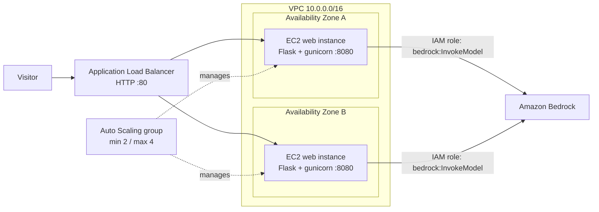
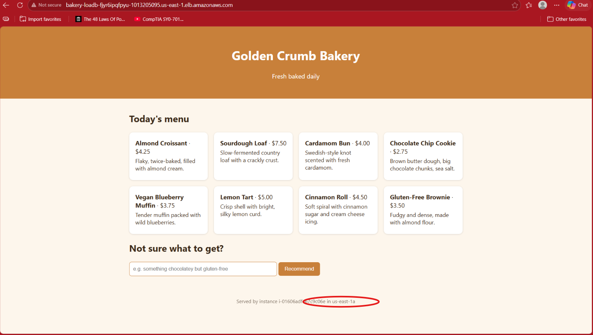
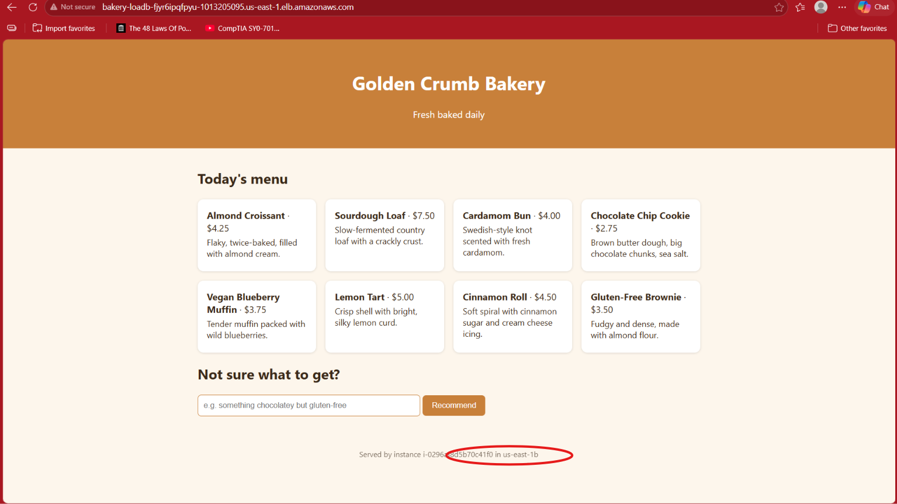
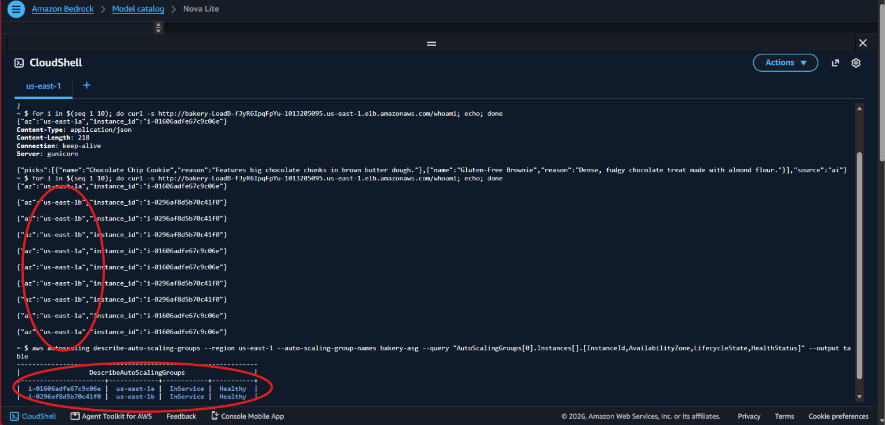
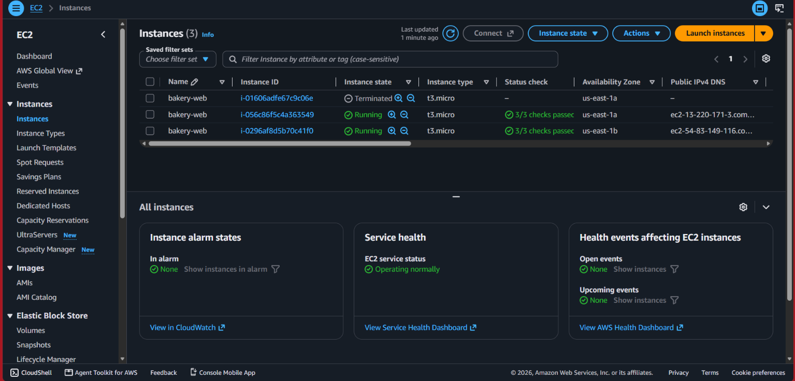
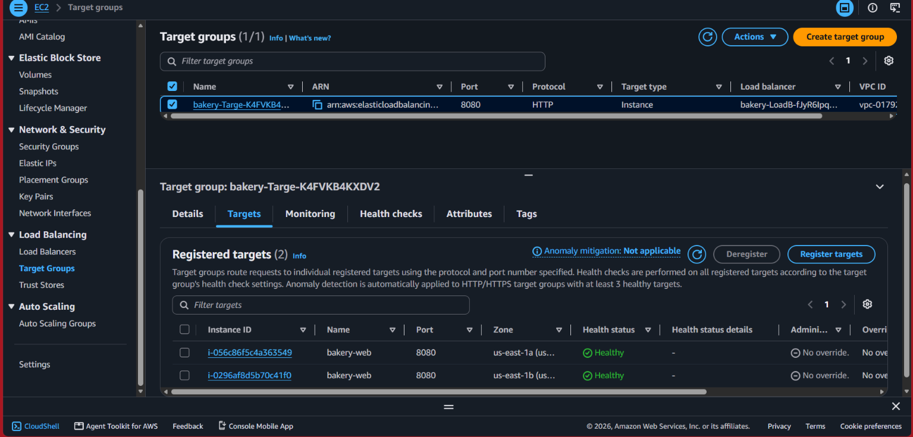

# Highly Available Bakery Website on AWS

A fault-tolerant website for a local bakery, deployed entirely with AWS CloudFormation. An Application Load Balancer sends traffic to web servers in **two Availability Zones**, managed by an Auto Scaling group. A "Not sure what to get?" feature uses **Amazon Bedrock** to recommend menu items, with a keyword-matching fallback so the site keeps working if the AI call fails.

## Architecture



| Layer | What it does |
|---|---|
| VPC with 2 public subnets (different AZs) | Network isolation, one subnet per AZ |
| Application Load Balancer + target group | Distributes traffic and health-checks `/health` every 15 seconds |
| Auto Scaling group (min 2, max 4) | Keeps two instances running across both AZs and replaces unhealthy ones |
| Security groups | The load balancer accepts port 80 from the internet; instances accept port 8080 **only from the load balancer** |
| IAM instance role | SSM Session Manager access (no SSH) and `bedrock:InvokeModel` only |
| Flask app | Menu page, `/health`, `/whoami` (shows which instance answered), and `/recommend` (Bedrock Converse API) |

## Deploy

**Prerequisites:** an AWS account, the AWS CLI (or AWS CloudShell), and access to the Amazon Nova 2 Lite model in Bedrock in your region. If a test call returns an access error, enable the model in the Bedrock console.

```bash
aws cloudformation deploy \
  --stack-name bakery \
  --template-file cloudformation/bakery-ha.yaml \
  --capabilities CAPABILITY_IAM \
  --region us-east-1

aws cloudformation describe-stacks --stack-name bakery --region us-east-1 \
  --query "Stacks[0].Outputs" --output table
```

Open the `SiteURL` output after about 3-5 minutes while the instances boot and pass health checks. The page footer shows which instance and Availability Zone served your request.

The default model is `us.amazon.nova-2-lite-v1:0`. To use another model or inference profile, add `--parameter-overrides BedrockModelId=<model-id>`.

To check that the AI path works (look for `"source":"ai"` in the response):

```bash
curl -s -X POST http://<SiteURL>/recommend \
  -H 'Content-Type: application/json' \
  -d '{"preferences":"something chocolatey"}'
```

## Fault-tolerance test

```bash
./scripts/failover_test.sh bakery us-east-1
```

The script terminates one web instance, then checks the site through the load balancer once per second for two minutes.

| Metric | Result |
|---|---|
| Requests succeeded / failed | 113 succeeded, 7 failed out of 120 (94.2%) |
| First failure | 3 seconds after termination (terminated 02:55:24, first HTTP 502 at 02:55:27) |
| Replacement instance serving traffic | About 2 min 18 s after termination (first response at 02:57:42) |
| Final state | 2 instances `InService` and `Healthy`, one in each Availability Zone |

While the replacement launched, the surviving instance in the other AZ served all traffic. The failed requests were HTTP 502 responses during the short window before the load balancer's health checks detected the failure and stopped routing to the terminated instance.

## Screenshots

| | |
|---|---|
|  |  |
|  |  |
|  |  |

## Security design

- **Least-privilege IAM:** the instance role can only invoke Bedrock and use SSM. No S3 access, no admin permissions.
- **No SSH or key pairs:** shell access, if ever needed, goes through SSM Session Manager.
- **Network least privilege:** the app port is reachable only from the load balancer's security group.
- **IMDSv2 required** on all instances, which mitigates SSRF-based credential theft.
- **Encrypted EBS volumes.**
- **Input and prompt controls:** user input is capped at 200 characters and treated as data in the prompt, and the app returns only items that exist on the menu (model output is validated server-side). Results are rendered with `textContent`, not `innerHTML`, to avoid XSS.

## Known limitations and next steps

1. **HTTP only.** Add a domain (Route 53), an ACM certificate, an HTTPS listener, and a redirect from port 80 to 443.
2. **Instances are in public subnets** to avoid NAT Gateway cost. A hardened version would use private subnets with VPC endpoints or a NAT.
3. **No WAF or rate limiting** on `/recommend`. AWS WAF with a rate-based rule would help control abuse and Bedrock cost.
4. **The IAM Bedrock resource is broad** (`foundation-model/*`). It should be scoped to the exact model or inference profile ARN.
5. **No logging or monitoring.** Next: ALB access logs, CloudWatch alarms, CloudTrail, and GuardDuty.
6. **Single region.** Multi-AZ survives an Availability Zone failure, not a regional outage.

## Cost and cleanup

The Application Load Balancer, two `t3.micro` instances, and public IPv4 addresses cost roughly 7-8 cents per hour in us-east-1, plus negligible Bedrock usage. Delete the stack when you finish testing:

```bash
aws cloudformation delete-stack --stack-name bakery --region us-east-1
```
